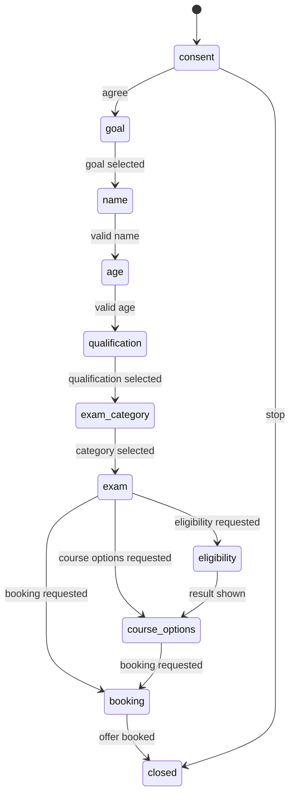

# Step 09i: Deterministic staged Telegram flow

## Stage diagram

The stage transition function is pure and receives `now` explicitly. It
accepts one input kind per stage. The flow context is persisted as JSON inside
the existing conversation context; the legacy `leads.stage` column remains
the preparation-stage field.

## Reused names

- `ConversationContext`, `handle_event`, `detect_intent`, and `handle_turn`
- `ChatMessageService.quick_replies_for` and `QuickReply`
- `ConsentService`, `LeadRepository`, `retrieve`, and `check_decision`
- `BookingService.create_offers` and `BookingService.book_offer`
- `TelegramMessenger` and `MessengerPort`
- Existing `approved_sources.yaml`, institute course data, and verification
  checks

## Changed files

- `.env.example`
- `alembic/versions/0005_staged_telegram_flow.py`
- `docs/steps/step09i.md`
- `src/coaching_inquiry_engine/adapters/messenger_fake.py`
- `src/coaching_inquiry_engine/agent/config.py`
- `src/coaching_inquiry_engine/agent/conversation.py`
- `src/coaching_inquiry_engine/config.py`
- `src/coaching_inquiry_engine/db/mapping.py`
- `src/coaching_inquiry_engine/db/models.py`
- `src/coaching_inquiry_engine/db/repositories/leads.py`
- `src/coaching_inquiry_engine/domain/flow.py`
- `src/coaching_inquiry_engine/domain/models.py`
- `src/coaching_inquiry_engine/main.py`
- `src/coaching_inquiry_engine/ports/messenger.py`
- `src/coaching_inquiry_engine/services/telegram_webhook.py`
- `src/coaching_inquiry_engine/worker.py`
- `tests/integration/test_telegram_webhook_db.py`
- `tests/unit/test_messenger_telegram.py`
- `tests/unit/test_staged_flow.py`
- `tests/unit/test_telegram_staged_worker.py`
- `tests/unit/test_text_keys.py`
- `tests/unit/test_worker_pipeline.py`

## Test counts

- `tests/unit/test_messenger_telegram.py`: 5 collected
- `tests/unit/test_staged_flow.py`: 15 collected
- `tests/unit/test_telegram_webhook.py`: 2 collected
- `tests/unit/test_telegram_staged_worker.py`: 6 collected
- `tests/unit/test_text_keys.py`: 3 collected
- `tests/unit/test_worker_pipeline.py`: 5 collected
- Unit suite: 434 collected
- `tests/integration/test_telegram_webhook_db.py`: 3 collected
- Integration suite: 35 collected (15 live LLM cases are excluded by the
  `integration` marker selection)

## Decisions and limitations

- The new flow stage is stored in the existing conversation-context JSON.
  `leads.stage` already means preparation stage, so migration 0005 leaves it
  unchanged. `leads.name` also already exists and is reused.
- Migration 0005 adds only missing nullable lead fields: `goal`, `age_years`,
  `qualification`, `exam_category`, `exam_id`, and `eligibility_status`.
- Eligibility is evaluated only from a VERIFIED source with an explicit
  supported age range and qualification list. Missing or unparseable verified
  rules produce `to_confirm` with the source notice URL; no eligibility facts
  were added to the approved source file.
- The non-injection behavior, safety rules, qualification priority, booking
  guard, outbound consent gate, and approved-source verification rules remain
  in their existing owners.
- No production text contains `TO_APPROVE`; review status remains metadata.
- `data/safety_keywords.yaml` and knowledge files were not modified.

## Verification status

- Targeted staged-flow tests: 15 passed.
- Ruff: passed.
- Strict mypy for domain and ports: passed.
- Full unit and integration runs could not complete in this Windows sandbox:
  pytest stalls before the first async test while Python's Proactor loop creates
  its self-pipe (`socket.accept`). Collection succeeds; 434 unit and 35
  integration tests are discoverable. The integration database was therefore
  not exercised in this run.
